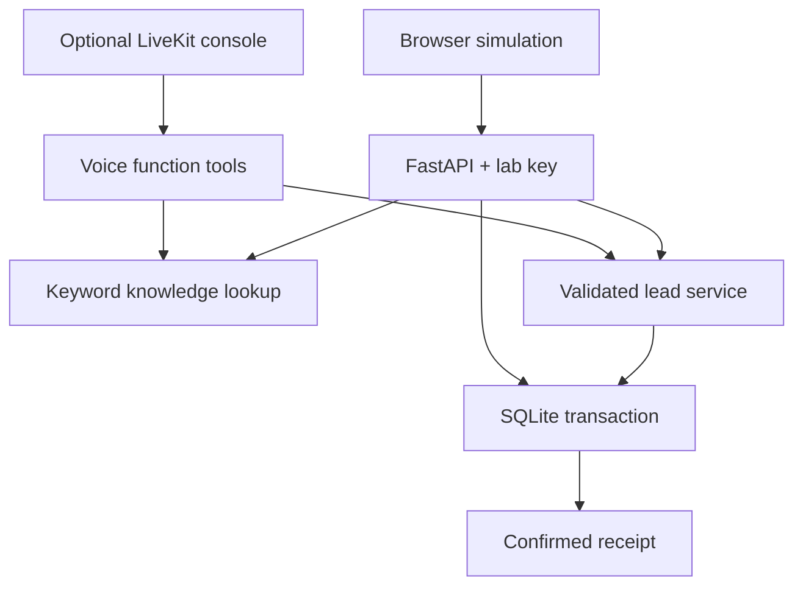

# Voice AI Lab

**Learn how a voice agent turns a conversation into a reliable business workflow.**

Created by **Mohamed Abdelaty**. MIT licensed. Python + FastAPI + SQLite, with an optional LiveKit / OpenAI Realtime voice exercise.

Start with a **free local simulation**: ask about fictional courses, inspect the retrieved sources, capture a test lead, retry safely, and deliberately fail a database write. No provider key, cloud database, phone number, or GPU is needed for this mode. After dependencies are installed, it runs without internet access.

This is a separate educational implementation inspired by my academy voice-agent work. It contains a new fictional catalog, new lab code, and a fresh git history. It does not contain EBH's knowledge documents, prompts, customer records, deployment settings, or production credentials.

## What you can do

| Free simulation | Optional real voice |
|---|---|
| Browser dashboard at `http://127.0.0.1:8080` | Speak through the LiveKit terminal console on your laptop |
| Deterministic keyword retrieval with visible source IDs | OpenAI Realtime calls the same retrieval and lead tools |
| SQLite commits and idempotent retry keys | Opt-in and your own provider key; API usage is billed |
| Write-failure drill and isolated automated tests | No phone calls, GSM, SIP, CRM, or payment integration |

The simulation is **not an LLM and does not synthesize speech**. Optional voice is an integration example; live model quality and audio latency require your own provider-enabled test run.

## Start locally

Requires Python **3.11 or 3.12**. Run the following from the repository root.

### With uv

Install [uv](https://docs.astral.sh/uv/getting-started/installation/) if needed, then:

```bash
uv sync --frozen --extra dev
uv run --frozen python scripts/setup_lab.py
uv run --frozen uvicorn voice_ai_lab.api:create_app --factory --host 127.0.0.1 --port 8080 --no-access-log
```

Open **http://127.0.0.1:8080**. Open your local `.env` file and copy `LAB_API_KEY` into the page. The key is randomly generated and is not stored by the browser.

### With regular Python / pip

```bash
python -m venv .venv
```

Activate it with `.venv\Scripts\Activate.ps1` in Windows PowerShell, or `source .venv/bin/activate` on macOS/Linux. Then:

```bash
python -m pip install --require-hashes -r requirements-dev.lock
python -m pip install --no-deps -e .
python scripts/setup_lab.py
python -m uvicorn voice_ai_lab.api:create_app --factory --host 127.0.0.1 --port 8080 --no-access-log
```

`setup_lab.py` preserves an existing `.env`. If you previously copied the blank `.env.example`, fill `LAB_API_KEY` with a random value of at least 24 characters, or remove that **unused local config only** and run setup again.

## Your first five minutes

1. Connect using the local lab key.
2. Ask **“Tell me about Python automation”**. Inspect the source IDs.
3. Ask **“xyzzy”**. You should get no match, not an unrelated course.
4. Save **Demo Learner / learner@example.com** after checking the consent box. Inspect the database receipt and dashboard row.
5. Submit the same unchanged form again. The server returns the same lead ID, not a duplicate.

Use only fictional contacts. The API accepts `example.com`, `example.org`, `example.net`, and `.test` email domains. It sends no emails and makes no outbound calls.

## Run the tests

```bash
uv run --frozen --extra dev pytest
uv run --frozen --extra dev ruff check .
uv run --frozen --extra dev ruff format --check .
```

Or, with the pip environment activated: `python -m pytest`, `ruff check .`, and `ruff format --check .`.

Tests use temporary SQLite databases, block socket connections, and require no external credentials. They cover persistence across restart, concurrency, safe retries, rollback, authentication, input validation, no-match retrieval, and failure recovery. CI runs the Python suite and Docker checks on pushes and pull requests.

## Break persistence on purpose

1. Stop the server.
2. Set `LAB_FAIL_WRITES=true` in `.env` and restart using the same command.
3. Change the fictional email or course so this is a **new request**; submit the form.
4. Expect **HTTP 503**, no new row, and no success receipt.
5. Stop, set `LAB_FAIL_WRITES=false`, restart, and retry the unchanged form while keeping that browser tab open.
6. Expect one committed row. A second retry reuses the result.

A previously successful request still replays successfully even while failures are enabled: its durable record already exists. The fault flag affects new writes only. Browser retries retain their request ID in page memory; refreshing the page starts a new request. Voice retries retain a key for the same payload within one session.

## Docker alternative

Requires Docker Engine/Desktop with Compose v2. The app is published only on the host loopback address. The image contains the free simulation only.

```bash
python scripts/setup_lab.py
docker compose up --build
```

Open `http://127.0.0.1:8080`. Read `LAB_API_KEY` from `.env` as above.

Run isolated tests:

```bash
docker compose --profile test run --build --rm tests
```

The test container has networking disabled. Runtime data lives in the `lab-data` Docker volume, separate from a Python launch's `.local/lab.sqlite3`. `docker compose down` stops containers and keeps data. `docker compose down -v` also **deletes the disposable Docker lab database**. After changing fault settings, use `docker compose up -d --force-recreate lab` to apply them.

## Add real voice after the free lab works

On a laptop with a microphone and speakers:

```bash
uv sync --frozen --extra dev --extra voice
```

In the local `.env`, explicitly set:

```dotenv
LAB_ENABLE_VOICE=true
OPENAI_API_KEY=YOUR_OWN_PROVIDER_KEY
LAB_REALTIME_MODEL=gpt-realtime
```

The model ID is configurable; use an OpenAI Realtime model available to your project. This uses the OpenAI plugin directly rather than LiveKit Inference. Do not put real keys in source code or commit `.env`.

```bash
uv run --frozen --extra voice python -m voice_ai_lab.voice console
```

Speak a course question, then ask to save fictional interest. The voice tool shares the same schema and SQLite persistence implementation as the web lab. Refresh the browser dashboard to see the record when both processes use the same database path.

Console mode runs locally without LiveKit media transport; the OpenAI model still uses the network and incurs provider usage charges. The browser simulation does not become a microphone client. Never copy your production `.env` into this project. Start with a separate provider project/key and a small provider-side spending limit. Do not use `--record` with personal information.

See [the voice guide](docs/voice-mode.md) for limitations and next steps.

## Architecture



## Learn and extend

- [Guided exercises](docs/learning-path.md): trace a request, reproduce a failure, add a course, then design your own evaluation.
- [Architecture and code map](docs/architecture.md): understand boundaries, retries, and what is deliberately omitted.
- [Voice integration](docs/voice-mode.md): turn on paid audio only when ready.
- [Security boundaries](SECURITY.md): understand why this lab should stay local.
- [Contributing](CONTRIBUTING.md): add a useful lesson or fix with a regression test.

Source inspiration: [my academy project](https://github.com/aicalling-netizen/ebh-academy-ai). This lab is not a copy of that production environment. Third-party dependencies retain their own licenses.
