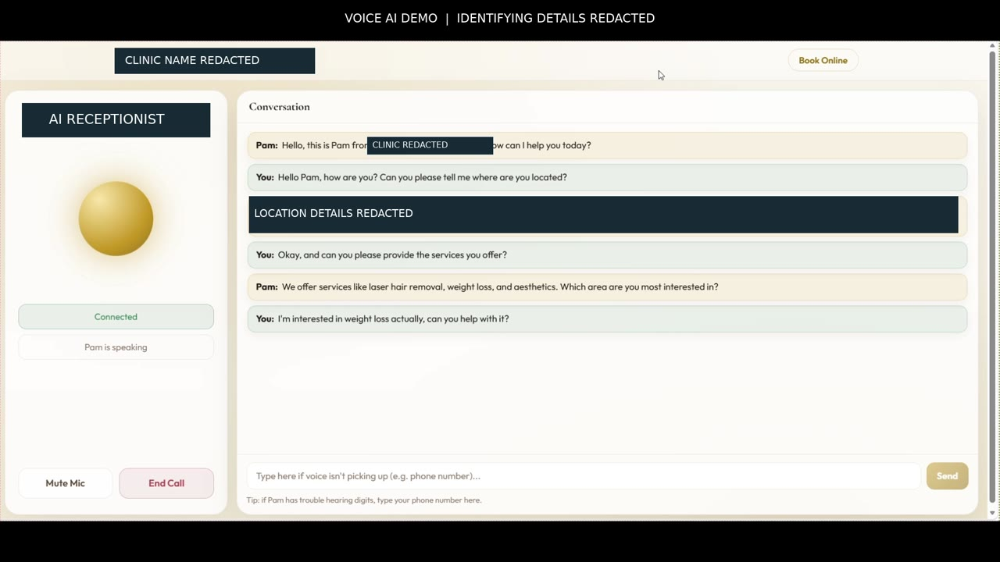

# Voice receptionist demo

Built by **Mohamed Abdelaty**.

[Watch or download the redacted recording](https://github.com/mabdelaty778-collab/voice-ai-lab/blob/main/docs/clinic-voice-demo-redacted.mp4) (MP4, 1920 × 1080, approximately 1 minute 46 seconds).

## What to watch

| Time | Interaction |
|---|---|
| 00:00–00:22 | Greeting and location question; identifying details are masked and muted |
| 00:23–00:40 | Service discovery and a follow-up question about weight loss |
| 00:42–01:02 | Multi-turn discussion of available services |
| 01:03–01:26 | Topic change to a different treatment and further explanation |
| 01:26–01:46 | Callback request and end-of-conversation interaction |

## Evidence and limits

The recording demonstrates an audible exchange and the application's conversation interface. It does not show a database commit, a delivered CRM event, a completed booking, a dispatched callback, a GSM/SIP call, or a load test. The callback language near the end is conversational output; this recording alone does not establish that a callback was scheduled. Treatment statements are demo dialogue, not clinical guidance or validated medical recommendations.

This is a recorded example of the original receptionist application. The educational lab in this repository has a different interface and a fictional academy catalog. Its free mode is deterministic and text based. The optional voice exercise requires the learner's own provider key and audio devices.

## Privacy edits

Opaque masks cover the clinic's branding and location text, including as the conversation scrolls. Matching spoken identifiers are removed and replaced with a short privacy tone. Generic conversation content remains. Use this redacted version when sharing the demo.

## Reproduce the engineering lessons

1. Follow the [README setup](../README.md#start-locally).
2. Run the [automated HTTP walkthrough](../README.md#run-the-automated-walkthrough).
3. Inspect source IDs, save a fictional lead, and repeat the same request.
4. Trigger a failed write and verify that the lab reports failure before retrying.
5. Add the [optional voice exercise](voice-mode.md) after the free lab works.

Read the [engineering case study](engineering-case-study.md) for ownership, tradeoffs, and the distinction between demo evidence and tested lab behavior.
