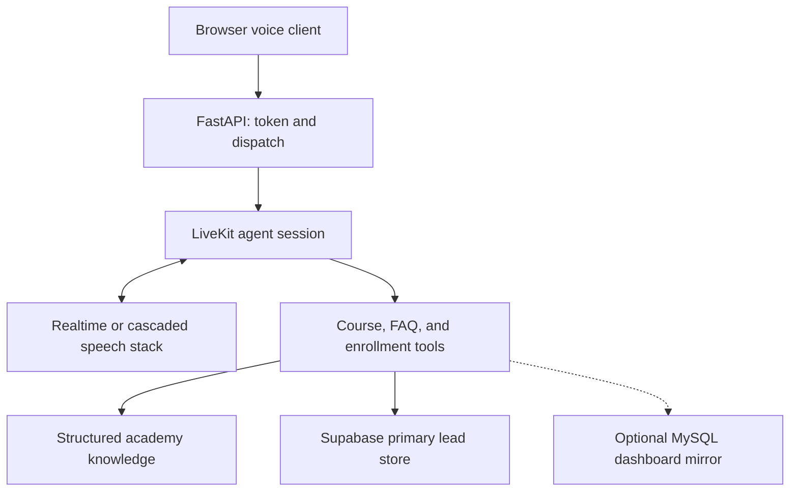

# Academy Voice AI: from live conversations to business workflows

**Mohamed Abdelaty · AI Engineer / Software Engineer**  
Source reviewed: **5 November 2026**

I built voice AI systems for a clinic and an academy, connecting conversations with dashboards, databases, CRM systems, and GSM/SIP infrastructure. This case study focuses on the academy application's web voice path: provider integration, knowledge tools, enrollment intake, and a documented Arabic speech-recognition failure.

**[Production source snapshot](https://github.com/aicalling-netizen/ebh-academy-ai/tree/c4ad4b55d361c3b9c5451141fe0355ad849686b6)** · **[Run the separate learning lab](../README.md#start-locally)** · **[Related clinic demo](demo.md)**

## The problem and my ownership

The academy needed a voice advisor that could answer course and policy questions, collect enrollment interest, and make that information available to admissions and dashboard workflows. The conversation had to connect to application services and business data.

My work covered the voice-agent implementation and its backend integrations. In the academy code, that includes FastAPI session access and dispatch, LiveKit agent tools, configurable speech providers, structured course and FAQ lookup, lead capture, and dashboard persistence integration. My broader clinic/academy work also includes telephony and CRM integration; those paths are outside the web flow documented here.

## Architecture

This diagram shows component responsibilities, not a guarantee that every business action completed. The agent's response, primary write, dashboard mirror, and callback notification are separate outcomes.

## Decisions and tradeoffs

| Decision in the implementation | Purpose | Tradeoff I need to account for |
|---|---|---|
| Configurable English Realtime and cascaded stacks | Support a speech-to-speech route and an independently configured STT → LLM → TTS route | Provider choice needs measured comparisons of response time, quality, and cost |
| Language-specific provider routing | Configure English, Arabic, Hindi, and Urdu paths | Having a route in code does not establish equivalent recognition or pronunciation quality |
| Tools over structured course and FAQ data | Retrieve business information through application functions | Keyword ranking needs explicit evaluation, especially when no useful result exists |
| Supabase as the primary store with an optional MySQL mirror | Feed the operational dashboard while retaining a primary data source | A best-effort mirror needs reconciliation and separate failure visibility |
| Mirror work moved to a thread | Keep its synchronous database work off the event loop | The tool still awaits that work, so it can add to completion time |
| Configurable silence watchdog for Realtime sessions | Warn after dead air and terminate sessions that remain idle | Thresholds need testing against pauses, interruptions, and different speaking patterns |

These are implementation choices visible in the linked source. They are not claims of a completed production performance or security audit.

## A failure I addressed: Arabic audio framing

The integration documented a specific STT failure: after the initial audio frames, the provider rejected continuation messages with a missing RIFF header error. The linked upstream report describes the issue with `livekit-plugins-munsit` 0.3.0. It records that batch recognition worked while the streaming path failed.

I implemented a direct WebSocket adapter that buffers audio into windows and prefixes each outgoing window with a WAV header. Its configured default flush interval is **500 ms**. It also handles incoming cumulative transcripts and translates connection errors into the agent SDK's error types.

The root cause should be described carefully. The upstream report proposes server-side validation or a mismatch in chunk cadence as possible explanations. The observable problem is rejection of continuation chunks; the adapter avoids the raw-PCM continuation path. I do not claim that the upstream issue itself is fixed.

The 500 ms setting is a buffering configuration, **not an end-to-end voice-latency measurement**. Provider acceptance, transcription quality, interruption behavior, and total response time still require live evaluation.

[Adapter rationale and defaults](https://github.com/aicalling-netizen/ebh-academy-ai/blob/c4ad4b55d361c3b9c5451141fe0355ad849686b6/core/munsit_streaming_stt.py#L1) · [Outgoing audio framing](https://github.com/aicalling-netizen/ebh-academy-ai/blob/c4ad4b55d361c3b9c5451141fe0355ad849686b6/core/munsit_streaming_stt.py#L187) · [Upstream incident report](https://github.com/CNTXTFZCO0/livekit-plugins-munsit/issues/1)

## A reliability boundary I make explicit

The reviewed academy snapshot contains lead capture, an optional dashboard mirror, and admissions escalation. It also has important limits: a conversational success message is not always conditional on a confirmed primary write or a verified notification result. Its generic retrieval fallback also needs evaluation for irrelevant queries.

I make those boundaries explicit in **Voice AI Lab**, the separate educational implementation I published. There, a successful lead receipt follows a committed transaction, repeat submissions use request-level idempotency, no-match questions return no sources, and a deliberate write failure produces a failure response. The lab demonstrates these properties with fictional data and isolated tests.

The production snapshot and the lab have different guarantees. I would validate committed persistence, callback delivery receipts, retries, and mirror reconciliation before presenting those production paths as confirmed business outcomes.

## Results and evidence

| What I can show | Evidence and scope |
|---|---|
| Academy voice-session and provider integration | [FastAPI session path](https://github.com/aicalling-netizen/ebh-academy-ai/blob/c4ad4b55d361c3b9c5451141fe0355ad849686b6/main.py#L154) and [agent stack selection](https://github.com/aicalling-netizen/ebh-academy-ai/blob/c4ad4b55d361c3b9c5451141fe0355ad849686b6/agent.py#L602) |
| An implemented workaround for the documented Arabic framing failure | The custom adapter and the linked upstream report; live success rates are not published here |
| Enrollment and dashboard integration code | [Enrollment tool](https://github.com/aicalling-netizen/ebh-academy-ai/blob/c4ad4b55d361c3b9c5451141fe0355ad849686b6/tools/enrollment_lead.py#L12) and [optional mirror](https://github.com/aicalling-netizen/ebh-academy-ai/blob/c4ad4b55d361c3b9c5451141fe0355ad849686b6/core/mysql_writer.py#L35); source inspection does not verify live records |
| Reproducible persistence and failure-handling lessons | The separate lab's recorded baseline is **36 passing isolated tests** with its optional voice SDK installed; [validation details](validation.md) |
| A working conversational interface from the related clinic application | [Privacy-edited recording](demo.md); this is not an academy call, a load test, or a booking receipt |

I have not published a defensible production benchmark for call volume, concurrent sessions, uptime, voice latency, cost per conversation, or conversion uplift. Those claims need operational records and a stated measurement method. I keep the published results limited to what the artifacts establish.

## Measurement tools now available

I added an opt-in, content-free session recorder, an offline outcome/cost reconciler, and a reproducible local benchmark. In the separate learning lab, **300 sequential API requests** returned their expected results; **32 concurrent retries** with eight worker threads produced one committed record. Injected write failure, restart durability, and recovery checks passed. These are local ASGI/SQLite measurements, not voice latency or production call results.

[Measurement method, recorded latency percentiles, and production collection plan](measurements.md) · [Aggregate benchmark receipt](local-benchmark.json)

## Next production validation

I would first trace each enrollment from tool invocation to a committed primary record and, separately, to its dashboard mirror. Callback requests need delivery status and retry handling. Failed actions must return a response the agent can explain accurately.

For performance, I would record the end of caller speech, first audible agent response, tool duration, language and provider route, provider usage, and outcome. I would report latency percentiles, failures, and cost together with sample size and test conditions. That would support an engineering claim that someone else can check.

The public lab lets a reviewer inspect the core reliability lessons today. The source links preserve the exact academy snapshot behind this case study without reproducing its business knowledge, prompts, customer data, or deployment configuration.
